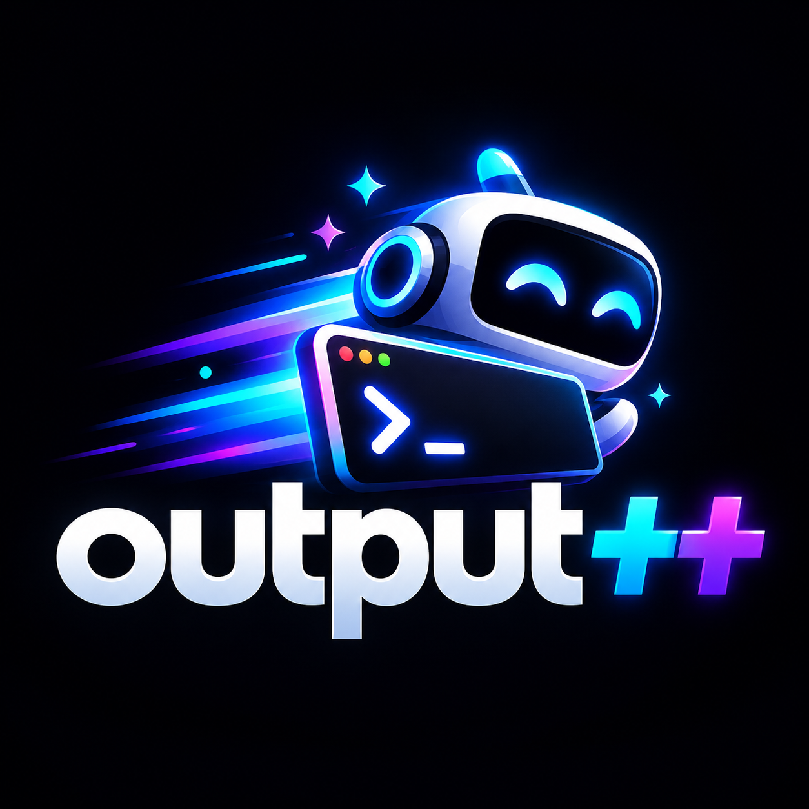

<p align="center">
  
</p>

# outputplusplus

[](https://github.com/crooruhe/outputplusplus/actions/workflows/ci.yml)
[](LICENSE)

**One string toolkit. Two runtimes. Identical results.**

outputplusplus gives you shouting, reversing, palindrome checks, and word
frequency as a **Python library and CLI**, and as a **React + Express web
app** — with the same behavioral contracts asserted on both sides. What you
test in Python is what your browser gets.

- **Deterministic by design** — a compatibility layer pins numerical and
  timing behavior across library versions, so results are reproducible
- **Batteries included** — CLI, JSON API, a UI, and an **MCP server** that
  puts the whole repository in front of your AI assistant
- **Tested end-to-end** — unit, API, and component tests, plus secret
  scanning, enforced in CI on every push and pull request

> [!NOTE]
> The codebase is intentionally written in an explicit, per-value style.
> Read [AGENTS.md](AGENTS.md) before refactoring.

## What's inside

| Path | Contents |
|---|---|
| [`python/`](python/) | Library + CLI (`opp`): strings, science/ML, plotting |
| [`typescript/`](typescript/) | React (Vite) frontend + Express JSON API |
| [`rust/`](rust/) | The hub: string utilities, repo glue, **MCP server** |

## Quick start

```bash
git clone https://github.com/crooruhe/outputplusplus
cd outputplusplus/python && pip install -e ".[dev]" && pytest && opp shout-cmd "hello"
```

```bash
cd ../typescript && npm install && npm run dev   # UI on :5173, API on :8787
```

Full setup, API reference, and development workflows: **[USAGE.md](USAGE.md)**

## Rust hub

The Rust crate is the project's glue: it discovers the Python and
TypeScript components, reads their manifests, and exposes everything
through an MCP server for AI assistants. See [USAGE.md](USAGE.md).

```bash
cd rust
cargo test
make mcp   # or: cargo run --bin outputplusplus-mcp (stdio MCP server)
```

## Documentation

| Doc | Purpose |
|---|---|
| [USAGE.md](USAGE.md) | Install, run, and develop every component |
| [CONTRIBUTING.md](CONTRIBUTING.md) | Ground rules for pull requests |
| [AGENTS.md](AGENTS.md) | Style contract (binding for humans and AI assistants) |
| [CHANGELOG.md](CHANGELOG.md) | Release history |
| [SECURITY.md](SECURITY.md) | Reporting vulnerabilities |

## License

MIT — see [LICENSE](LICENSE).
